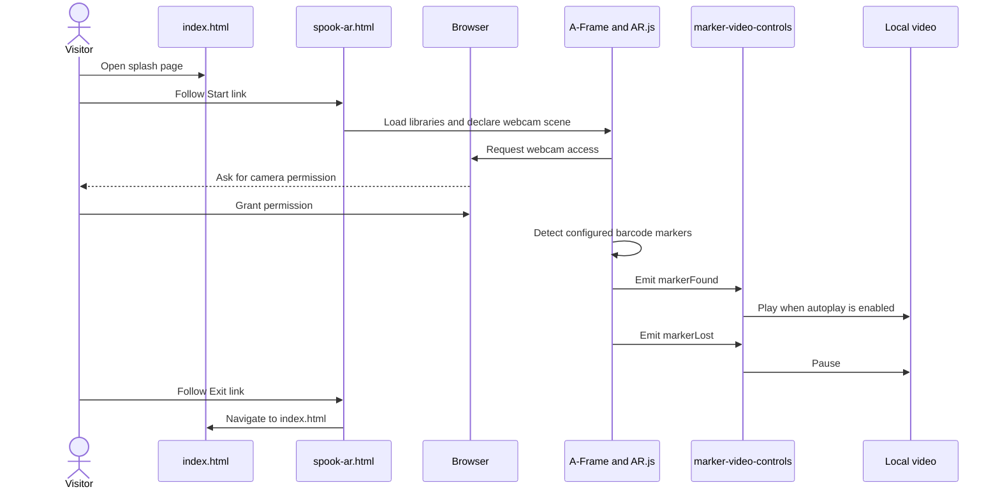

# AR runtime and user journey

SpookAR is a small, page-navigation-driven browser AR experience. `index.html` is an instructional splash page; following its Start link loads `spook-ar.html`, where A-Frame and AR.js create a webcam-backed scene. The scene recognizes a fixed barcode family and binds each configured marker to a local video. The custom `marker-video-controls` component turns AR.js marker events into video play/pause behavior. Exit is ordinary navigation back to the splash page, not an in-scene reset.

## End-to-end journey

*The diagram shows the normal camera permission, marker event, media, and page-navigation path; the repository implements no custom permission or recovery screen.*

### 1. Splash and entry

`index.html` presents the SpookAR logo, brief prompt, scanning instructions, and a Start button. Both the logo and Start link navigate to `spook-ar.html`; no application state is passed between pages. The instructions tell the visitor to grant camera permission and scan the physical decorations.

The splash owns the entry explanation and navigation only. Its content is ordinary HTML, while `styles.css` supplies the centered black splash layout, typography, responsive image sizing, instructions, and button styling. The page does not load or initialize the AR stack.

### 2. Scene startup and scanning

`spook-ar.html` loads A-Frame 1.6.0, the AR.js A-Frame build, and then `scripts/marker-video-controls.js`. It declares an embedded `<a-scene>` with `sourceType: webcam`, `debugUIEnabled: false`, `detectionMode: mono_and_matrix`, and `matrixCodeType: 4x4_BCH_13_5_5`. AR.js therefore owns camera-backed tracking and barcode detection; the page supplies the scene configuration and one `<a-entity camera>` to support multiple markers.

Camera access is required for the experience, as the README and splash instructions state. The application does not include a permission prompt implementation, explicit permission-status state, or a fallback/retry interface: startup and camera failure behavior are left to the browser and AR.js. The referenced libraries are loaded from external URLs, while the scene's video media is stored in the repository's `assets` directory.

The chosen matrix-code type is an integration invariant, not just a per-marker setting: the documented physical targets must use that same barcode family. The README cautions against mixing barcode families within the page. It lists the active family as `4x4_BCH_13_5_5` and points to the project's `print` materials for physical targets.

### 3. Marker-to-video presentation

The scene's `<a-assets>` block defines seven local MP4 `<video>` elements. Each has a unique DOM ID, looping enabled, inline-playback attributes, native controls, and an `assets/...` source. A corresponding barcode `<a-marker>` references the video in `marker-video-controls` and in its child `<a-video>` primitive. The primitive's dimensions, position, and rotation determine how the video is placed relative to the detected marker; these are scene/presentation choices rather than behavior implemented by the custom component.

The current mappings are barcode values 6, 7, 8, 10, 11, 12, and 13 to the T-Rex, Dilophosaurus, Mosasaurus, Star-Lord, Doctor Strange, Drax, and Mantis media respectively. The mapping is explicit HTML configuration; there is no runtime catalog or data-driven discovery mechanism. The related [marker-video catalog](/openwiki/concepts/marker-video-catalog.md) is the place for the current catalog detail.

For every marker, the HTML enables AR.js marker events (`emitevents="true"`) and configures a mouse-origin cursor alongside the custom component. These are important to the component's event-driven playback and click interaction; adding an asset alone does not establish a playable marker experience.

### 4. Component lifecycle and playback

On component initialization, `marker-video-controls` resolves its `video` selector and looks for an `a-video` child under the marker. If either reference is missing, it logs an error and returns without attaching its click, `markerFound`, or `markerLost` handlers. It does not create missing media or scene nodes.

When initialized successfully:

- `markerFound` calls `video.play()` only if the component's `autoplay` setting is true. All current markers configure it as true.
- `markerLost` always calls `video.pause()`, even if autoplay is disabled.
- On `click`, it reads `event.detail.intersectedEl` and toggles the video only if that element is the marker's `a-video` child or the marker itself, and the marker's `visible` attribute is not the boolean `false`.

The component coordinates playback; AR.js supplies marker events and A-Frame/cursor interaction, while the HTML video element and `<a-video>` primitive provide media and its rendered surface. The component does not explicitly rewind playback on marker loss, clear an ended position, handle rejected `play()` promises, or reconcile simultaneous marker visibility. Since media loops, a later play resumes according to browser media behavior rather than a component-managed reset. Native video controls are also present on the source elements.

## Ownership boundaries

| Layer | Owns | Does not own |
| --- | --- | --- |
| `index.html` and `spook-ar.html` | Page content, navigation links, external script inclusion, scene/asset/marker declarations, scanner and marker configuration | Styling rules or custom video playback logic |
| `styles.css` | Splash layout and appearance, instruction styling, and prominent positioned Exit control | Camera setup, marker detection, or media lifecycle |
| A-Frame / AR.js scene | Webcam source integration, configured barcode detection, scene graph, camera, marker visibility/events, and rendered video planes | The authored marker-to-asset mapping or app-level permission recovery |
| `scripts/marker-video-controls.js` | Resolving a marker's video and plane, then mapping marker/click events to play and pause | Camera permission, barcode definitions, media loading, presentation geometry, or navigation |
| Browser | Camera permission, HTML media execution, and page navigation | Application-specific recovery behavior, which is not implemented here |

The scanner page uses inline body styles (`margin: 0px; overflow: hidden`) to keep the AR view viewport-oriented. Shared CSS styles the Exit button as a high-z-index control in the upper-right corner. Exit is an anchor to `index.html`; navigating away unloads the scene/page rather than sending a teardown command to the component.

## Extension and operational guidance

To add a marker experience, add a local MP4 under `assets`, give its `<video>` a unique ID in `<a-assets>`, and add a barcode marker with an unused value, a `marker-video-controls` selector for that ID, and a child `<a-video>` using the same source. Keep the barcode type consistent with the scene's `matrixCodeType`, and supply a physical target from the matching barcode family. Keep marker events and cursor configuration aligned with the existing declarations. The README's example shows the required structure; [adding a marker experience](/openwiki/workflows/add-marker-experience.md) covers that workflow, and [the browser AR stack](/openwiki/integrations/browser-ar-stack.md) covers the dependency integration boundary.

Serve the site with its referenced files and media paths intact. The README describes deployment as uploading the static HTML, CSS, scripts, and local resources to a web host. The AR libraries themselves are fetched from the external URLs in `spook-ar.html`; an outage or incompatible change there can prevent scene startup. The repository does not implement a local library fallback or an in-app diagnostic flow.

## Validation that matters

There are no automated test files in this repository for this browser lifecycle. Validate the actual browser path on a device/browser with camera access, rather than treating page load as proof of AR operation:

1. Open `index.html`, check the splash instructions and both Start targets, and enter the scanner page.
2. Grant camera access and confirm the live camera view appears; also observe the browser behavior when access is denied, since there is no app-specific recovery flow.
3. Scan each configured printed barcode. Verify its expected video appears at the marker and starts; move the marker out of view and confirm the video pauses.
4. Test click interaction on the rendered video/marker and confirm it toggles playback; check that one marker's interaction does not accidentally control another marker's video.
5. Use Exit and confirm navigation returns to the splash page.

The README's screenshot examples and print-folder targets can help select representative visual cases. For a test-oriented checklist, see [manual validation](/openwiki/testing/manual-validation.md).